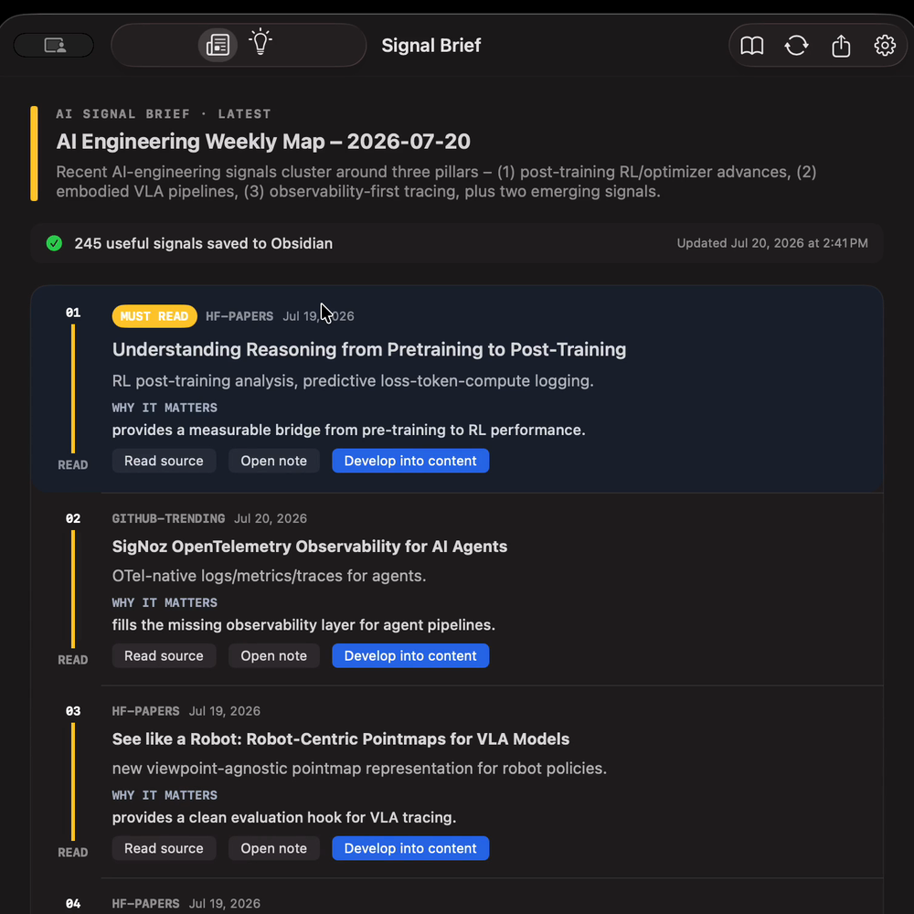
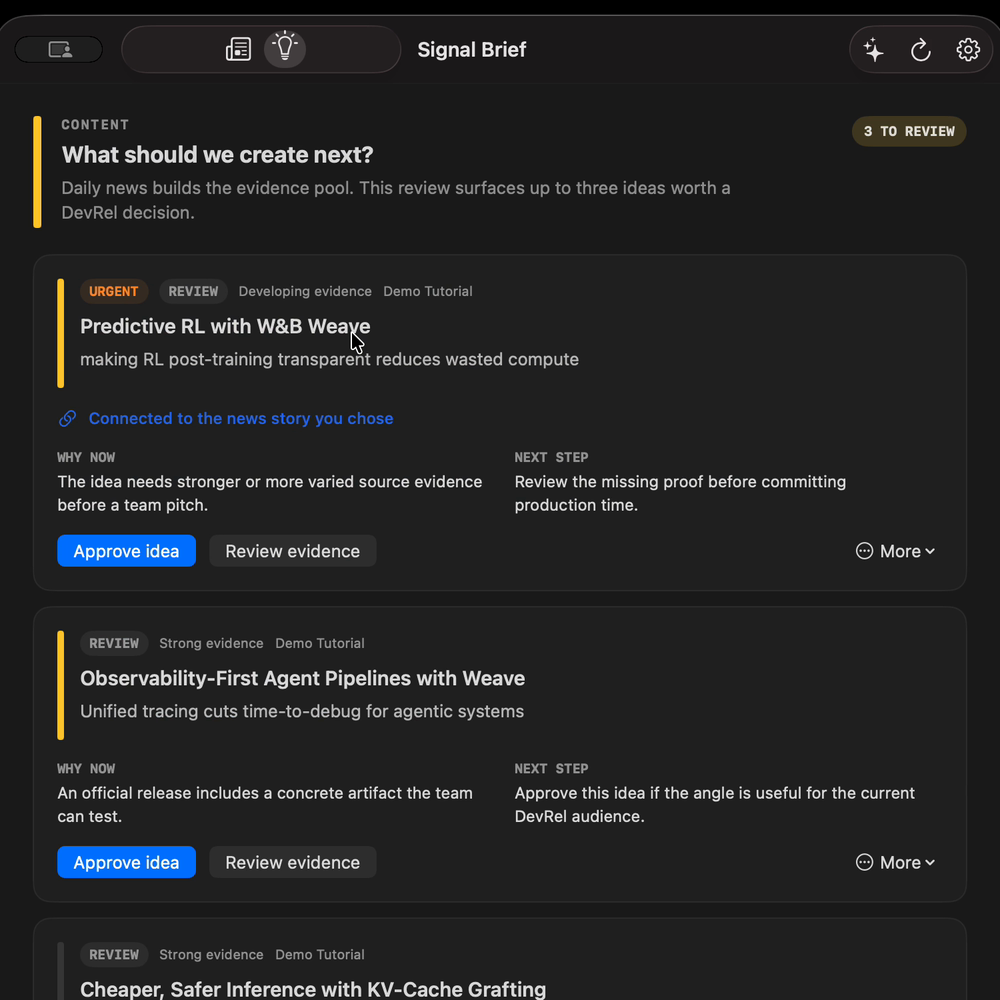
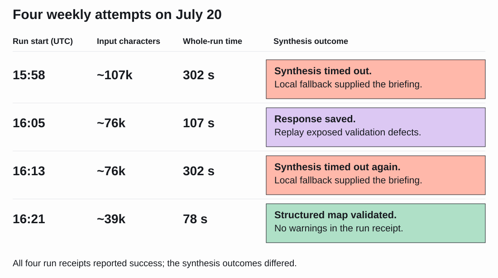
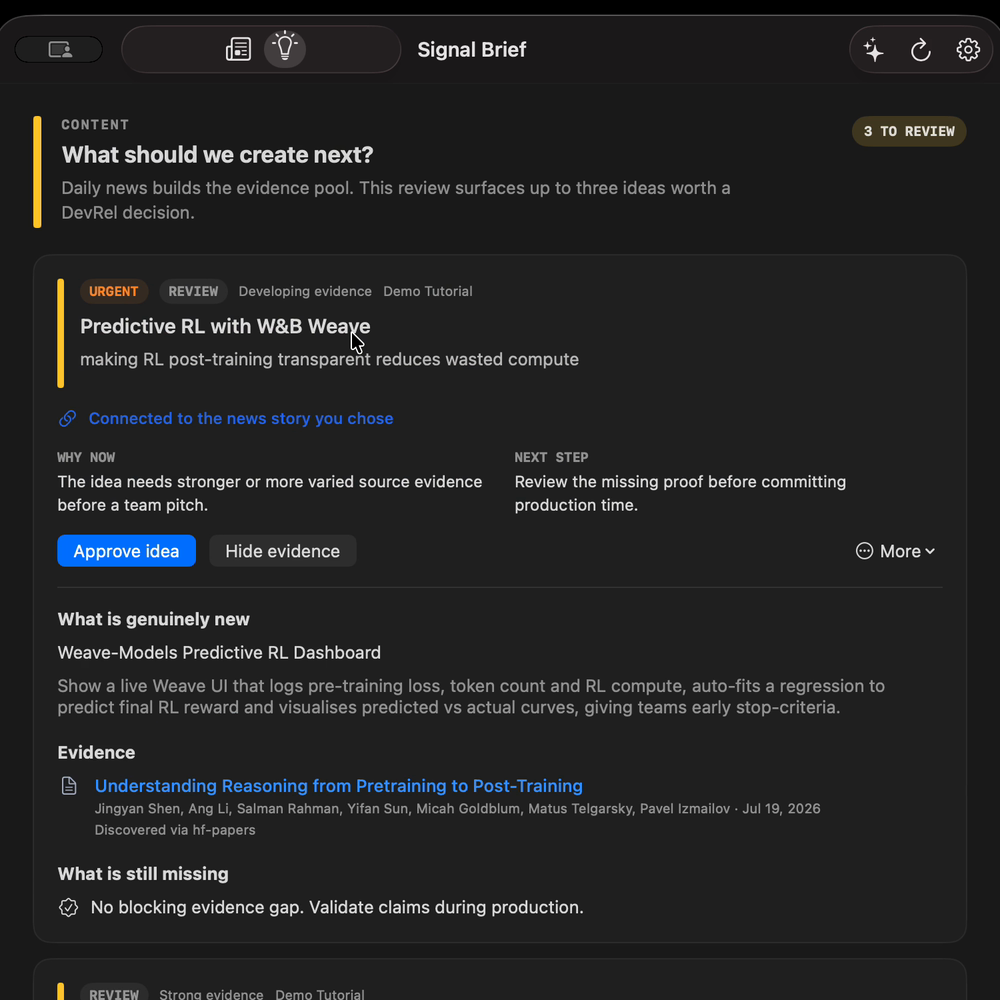

**HOW AGENT ENGINEERS WORK**

# How I Built Signal Brief With Coding Agents

*I used Codex to build the app, Forge Inference to run its research models, and Weave inside CoreWeave Forge to work out what needed fixing when a weekly run went wrong.*

## What I wanted from Signal Brief

I built Signal Brief to help me decide what to read and what might be worth turning into an article, demo, or experiment. The sources were already there: papers, repositories, model releases, and the people I follow. Connecting them took more work. I wanted to see what supported an idea, what contradicted it, and what I would still need to test before spending time on it.

Those are different decisions. A paper can be worth reading without being a good article idea. A new repository might make an interesting demo, but only after I've tried it. Several sources might point toward the same change in how people build agents, even if none makes a convincing story on its own.

Signal Brief collects those sources and gives me two places to work. News shows up to five ranked stories, with a summary, source link, and explanation of why each matters. Content proposes at most three ideas and lets me review their supporting evidence before approving anything. I can follow a source out to the original article, open its note, or consider doing more with it.

<figure class="product-pair">

<figcaption>News helps me choose what to read; Content gives me proposals to examine before committing to work. These are genuine installed-app captures. Open <a href="assets/news.png">News at full size</a> or <a href="assets/content.png">Content at full size</a> to read the details.</figcaption>
</figure>

I also needed this to remember more than the current week. Otherwise the same announcement could keep arriving as a new idea, with no record of the related paper I'd already saved or the reason I'd set it aside. SQLite stores the scored items and research history locally. Obsidian makes the sources and notes available outside the app, where I can keep reading and developing them. The desktop widget offers a read-only summary; opening it doesn't start another model call.

I used Codex to work across the TypeScript research pipeline and the native macOS app. My part was deciding what those screens should help me do, what evidence they needed to expose, and which actions should require approval. That became much more specific once we had a real run to debug.

## The two model jobs

Most collected items don't need the full research history to be scored. They need a relevance judgment and a short take. I gave that per-item work to `gpt-oss-20b`, running in parallel through [Forge Inference](https://forge.coreweave.com/inference/models), and stored the results so a weekly rebuild could reuse them.

Connecting sources is a different request. For that, `gpt-oss-120b` receives a selected set of current candidates and supporting history, also through Forge Inference. I want it to identify connections, distinguish an emerging pattern from a single announcement, and preserve contradictions or missing proof. The smaller model handles the volume; the larger one gets the cross-source work. This was a practical division of responsibilities, not a benchmark establishing that these were the best possible models.

<table class="model-roles">
<thead><tr><th>Model on Forge Inference</th><th>Responsibility</th></tr></thead>
<tbody>
<tr class="triage"><td><code>gpt-oss-20b</code></td><td>Score individual sources in parallel and save their takes.</td></tr>
<tr class="synthesis"><td><code>gpt-oss-120b</code></td><td>Connect selected sources into a research map, ranked stories, and proposed ideas.</td></tr>
</tbody>
</table>

The research map is the structured account behind the screens: which sources support a signal, which signals belong to a trend, and what evidence supports a proposed piece of work. In code, it's `ResearchMapV1`. The ranked stories in News and the proposed ideas in Content are both derived from that map.

An evidence brief is a separate step. When I ask for one, another 120B call expands an approved idea into a sourced project brief. That doesn't happen just because an idea appeared in Content. Generating the brief and handing work to a team are explicit actions; neither is the model approving its own suggestion.

This gave me a workable pipeline, but it also put a lot of responsibility on the synthesis request. The first weekly attempt in this sequence showed how much.

## The weekly run finished through fallback

On July 20, the synthesis prompt was roughly 107,000 characters. It carried 40 current candidates along with too much historical evidence and novelty context. The 120B request timed out after about five minutes.

The run receipt still said `succeeded`. Signal Brief could produce a grounded, deterministic fallback from stored evidence, so the overall job had finished. That status answered whether the app had produced an output. It didn't tell me whether the synthesis model had produced the research map I wanted.

Weave exposed the request and its failure inside that apparently successful run. The useful detail was what we had actually sent: the prompt included a large amount of supporting history around the current candidates. With Codex, I reduced that historical context while retaining the current sources we wanted the model to compare. There was no silent switch to another provider. The fallback was application code, not a second model trying the request again.

The next attempt used roughly 76,000 characters and returned a structured response. Its whole-run receipt took about 107 seconds. Now we had an output to inspect, and that revealed a different set of problems.

## Debugging the saved response with Codex

One proposed idea had `trendIndex:0` where its thesis should have been. The model had copied a schema reference into the content. Some trusted source IDs appeared more than once. Another item paired a valid source ID with the wrong headline. Following that link would take me to a source that didn't match the story the app was presenting.

The last problem was especially important for this product. I was using those source links to decide whether an idea had support. Checking that an ID existed wasn't enough if the title and summary beside it described something else.

We saved the response and replayed it locally with Codex while changing the validation code. We could test every code change against the same failing output without paying for a new response that might fail differently.

The repairs were deliberately specific. The validator could replace the exact known schema echo using the response's grounded `expectedValue` field; it couldn't invent a thesis for arbitrary invalid output. For repeated sources, it kept the first occurrence of a known ID and continued rejecting unknown IDs. For the mismatched headline, trusted code restored the title and summary from the stored source record associated with that ID.

Codex added regression tests around those cases. Each test had a concrete failure to preserve: schema vocabulary presented as a thesis, duplicate evidence, or display text detached from its source. That was a more useful coding task than asking for a generally better research map.

<figure class="run-timeline">
<a href="article-figures/build-story-runs.svg" aria-label="Open the four-run timeline at full size">
<picture>
<source media="(max-width: 640px)" srcset="article-figures/build-story-runs-mobile.svg">

</picture>
</a>
<figcaption>Several changes occurred between attempts, and later runs still timed out. This sequence records the debugging work; it doesn't isolate the effect of prompt length. Sizes are approximate characters, and durations cover the whole run. <a href="article-figures/build-story-runs.svg">Open the full-size timeline.</a></figcaption>
</figure>

A further attempt at roughly 76,000 characters timed out again. We shortened the supporting context further, keeping 40 balanced current candidates, and added a regression test requiring the prompt fixture to stay below 50,000 characters. That test guards against accidentally expanding the prompt again; it isn't a runtime guarantee that requests below that size will finish.

The next observed prompt was roughly 39,000 characters. It produced a validated map with no receipt warnings. Before treating that as a working feature, we still needed to see what the installed app did with it.

## Checking the installed app

The Content screen was opening the daily context rather than the weekly one. It also defaulted to a Pitch-only filter, which hid ideas marked Investigate, and its vertically centered empty state was clipped. Valid results existed, but the screen didn't give me a useful account of them.

Codex followed those states through the native UI. We changed the time horizon to the weekly research context, selected the first recommendation filter containing available work, and corrected the empty-state layout. Tests covered the behavior, and checking the installed app let us verify what a reader could actually reach.

Expanding an idea's evidence is the important part of that check. I need to see which story it connects to, what the app considers genuinely new, and which sources support it. I also need to see the gap assessment before approving the idea.

<figure class="evidence-shot">

<figcaption>The expanded review puts source evidence beside the approval decision. This example reports “No blocking evidence gap. Validate claims during production.” That is an assessment for me to check, not proof that the proposed work is correct. <a href="assets/evidence.png">Open the complete capture at full size.</a></figcaption>
</figure>

The app still leaves the decision with me. I can inspect the original source, decide that the proposed angle needs an experiment, or leave it alone.

## What the working run gave me

The verified run rebuilt the weekly map from **245 cached evidence items**. It made **zero new triage calls**: those items had already been scored. From that pool, the pipeline selected **40 candidates across five evidence lanes** and produced **five ranked stories and three ideas**. Trusted code assigned **one Pitch and two Investigate** recommendations. Those labels weren't model verdicts or human approvals.

The whole run took **77.679 seconds**, including the work around synthesis. That's the receipt duration, not a measurement of inference latency alone.

For my workflow, what mattered was getting a bounded reading list—five stories and three sourced proposals—with the original papers and repositories still attached. The stories gave me somewhere to start reading. The ideas gave me something to review, investigate, or turn into an evidence brief. I still had to decide whether an angle was useful to other engineers and what I'd need to build or test to support it. This run doesn't establish the quality of every recommendation.

The captured failures also changed how I could work with Codex. Instead of asking it to improve the output and waiting for another run, I could give it the saved response, the source record it should match, and the behavior I wanted tested. Then we could check the same case in the validator and follow it into the installed app. I'd use that assignment again: preserve the failing example, make the expected behavior explicit, and verify the result where I'll actually use it.

---

## Evidence and provenance

This is a field report about the July 20–21 build, not a controlled comparison of coding agents or observability tools. The reviewed [editorial snapshot](editorial-snapshot.json) supplies the historical counts and run sequence. Its canonical content SHA-256 is `aff77cf4312ced691f578c5099f2371cfac6930afe66f6f763366b0c5c9b4a09`.

- [Source repository](https://github.com/LorenzoWandB/News-Research-Agent), [field-note source commit](https://github.com/LorenzoWandB/News-Research-Agent/commit/55acb9419f7f40147f3a1affe47268dc8b8814b0), and [repair commit with regression tests](https://github.com/LorenzoWandB/News-Research-Agent/commit/0aa060258ea0f063cf50024b256461ba2daf7d47). Repository access requires authentication.
- [Forge Workspace project](https://forge.coreweave.com/wandb/wandb/news-research-agent) and [historical Agent Lens project](https://forge.coreweave.com/agent-lens/a-sh0ts/news-research-agent). The historical calls belonged to `a-sh0ts/news-research-agent`; the report uses `wandb/news-research-agent`.
- [Companion engineering report](https://forge.coreweave.com/wandb/wandb/news-research-agent/reports/Building-Signal-Brief-With-Coding-Agents:-A-Trace-Backed-Engineering-Field-Report--VmlldzoxNzU0OTcyMA==), [existing interactive film](signal-brief-agent-engineering.html), and [MP4](signal-brief-agent-engineering.mp4). Those earlier publication artifacts are unchanged by this article revision.

The four receipt IDs are `2026-07-20T15-58-49-039Z-weekly`, `2026-07-20T16-05-59-927Z-weekly`, `2026-07-20T16-13-05-709Z-weekly`, and `2026-07-20T16-21-26-835Z-weekly`. They preserve whole-run status, duration, routes, project identity, and conversation IDs. The current Calls query returned no rows for reconstructing exact historical call links, so these remain **receipt-only** references. Approximate prompt sizes and the response incidents come from contemporaneous inspection; historical token and cost totals are unavailable here. Raw prompts and responses are not published.

A later run overwrote the same-day current digest and map. The final-run composition above therefore comes from the reviewed historical snapshot, not those mutable files. The News, Content, and expanded-evidence images are approved installed-app captures from **July 21, 2026**, illustrating the product rather than frames of the July 20 run. The same complete captures appear on desktop and mobile; no UI has been reconstructed for this article.
